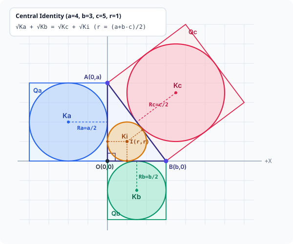

# Pythagoras Circles — Canonical Geometry Research Laboratory

**Russian Title:** *Лаборатория математических кругов Пифагора — Каноническая геометрическая лаборатория*  
**Proposed GitHub Repository:** `pythagoras-circles-canon-geometry-lab` · **Version:** `1.2.0` · **License:** [MIT](LICENSE)

*Canonical interactive mathematical and geometric research laboratory exploring the Pythagorean theorem, incircle and Thales circles, incenter partition, and parametric spectral analysis.*

[Русская версия (`README_RU.md`)](README_RU.md) · [Canonical Documentation](docs/canonical/README.md) · [Canonical Overview](docs/canonical/01_CANONICAL_OVERVIEW.md) · [Mathematical Model](docs/canonical/02_CANONICAL_MATHEMATICAL_MODEL.md) · [Architecture](docs/canonical/05_CANONICAL_ARCHITECTURE.md) · [Formula Passports (`F01`–`F19`)](docs/canonical/formula-passports/README.md) · [Stage 7.2 Pre-Publication Audit](docs/canonical/pre-publication-audit/README.md)

---

## 1. Overview

**Pythagoras Circles — Canonical Geometry Research Laboratory** (`pythagoras-circles-canon-geometry-lab`) is an interactive React, TypeScript, and Vite mathematical research laboratory built around a deterministic geometric state of a Euclidean right triangle, investigating:

- A right-angled triangle ($\triangle ABC$ in canonical opposite-side coordinates; $\triangle OAB$ in the runtime UI frame),
- Three exterior squares constructed on its sides ($Q_a, Q_b, Q_c$),
- Three circles inscribed in those exterior squares ($K_a, K_b, K_c$),
- The triangle's own incircle ($K_i$) centered at the incenter $I(r, r)$,
- The **Incenter Partition** decomposing the triangle into three sub-triangles sharing incenter $I$ and common altitude $r$ ($S = S_A + S_B + S_C = p \cdot r$),
- The **Thales Circumcircle ($K_o$)** circumscribed around the right triangle with the hypotenuse as diameter,
- **Parametric Spectral Ratio & Scale Analysis** over dimensionless shape ($\rho = \text{sideA}/\text{sideB}$ or $t = b/a$) and homogeneous scale ($\lambda = c/5$), and
- Six experimental arc-driven and incircle-first modules (**Experiments 01–06**).

---

## 2. Core Mathematical Ideas & Dual-Frame Equivalence

### 2.1 Central Four-Circle Identity & Area Contrast
Equating exterior square areas via the Pythagorean theorem implies $K_a + K_b = K_c$ for the square-inscribed circles. Introducing the triangle incircle $K_i$ yields a **linear-scale square-root identity** holding for all non-degenerate Euclidean right triangles:

$$\sqrt{\operatorname{Area}(K_a)} + \sqrt{\operatorname{Area}(K_b)} = \sqrt{\operatorname{Area}(K_c)} + \sqrt{\operatorname{Area}(K_i)}$$

Simultaneously, direct summation of areas produces a strictly negative area contrast:

$$\operatorname{Area}(K_a) + \operatorname{Area}(K_b) - \operatorname{Area}(K_c) - \operatorname{Area}(K_i) = -\operatorname{Area}(K_i) < 0$$

### 2.2 Incenter Partition Identity
Connecting the incenter $I(r, r)$ to the three vertices splits the right triangle into three sub-triangles with common altitude $r$:

$$S = S_A + S_B + S_C = p \cdot r, \qquad p = \frac{a + b + c}{2}, \qquad r = \frac{ab}{a + b + c} = \frac{a + b - c}{2}$$

### 2.3 Canonical Opposite-Side Standard (`CANONICAL_OPPOSITE_SIDE_V1`) vs. Runtime UI Frame
The repository maintains two algebraically isomorphic coordinate conventions linked explicitly by [`src/canonical/legacyMapping.ts`](src/canonical/legacyMapping.ts) (verified to $\le 10^{-12}$):

| Quantity | Canonical Core (`src/canonical/canonicalFourCircles.ts`) | Runtime UI Engine (`src/math/FourCirclesModel.ts`, `IncenterPartition.ts`) | Equivalence |
| :--- | :--- | :--- | :--- |
| Right-angle vertex | $C = (0, 0)$ ($\gamma = 90^\circ$) | $O = (0, 0)$ (aliased `C` in `IncenterPartition.ts`) | Same origin |
| Vertices $A, B$ | $A = (0, \text{sideB})$, $B = (\text{sideA}, 0)$ | $A = (0, a)$, $B = (b, 0)$ | $\text{sideA} \equiv b,\; \text{sideB} \equiv a$ |
| Leg naming rule | Opposite vertex: `sideA` $= |BC|$, `sideB` $= |AC|$ | Coordinate leg: `a` $= |OA|$, `b` $= |OB|$ | Explicit leg swap |
| Shape parameter | $\rho = \text{sideA} / \text{sideB} = \tan\alpha$ | $t = b / a$ | $\rho \equiv t$ |
| Sub-triangle $S_A, S_B$ | $S_A^{\text{canon}} = \frac{1}{2}\text{sideA}\cdot r$ ($\triangle IBC$), $S_B^{\text{canon}} = \frac{1}{2}\text{sideB}\cdot r$ ($\triangle IAC$) | `SA` $= \frac{1}{2}a r$ ($\triangle CAI$), `SB` $= \frac{1}{2}b r$ ($\triangle CBI$) | `SA` $\equiv S_B^{\text{canon}}$, `SB` $\equiv S_A^{\text{canon}}$ |

*(Note: Experiment 06 in [`src/math/experiments/arcSideAreaCorrespondence.ts`](src/math/experiments/arcSideAreaCorrespondence.ts) uses the canonical opposite-side indexing $S_a = \frac{1}{2}|OB|r$, $S_b = \frac{1}{2}|OA|r$, $S_c = \frac{1}{2}|AB|r$.)*

### 2.4 Geometric Layer Summary (`CANONICAL_OPPOSITE_SIDE_V1`)



| Circle | Geometric Role | Center (`CANONICAL_OPPOSITE_SIDE_V1`) | Radius | Area |
| :--- | :--- | :--- | :--- | :--- |
| **$K_a$** | Inscribed in square $Q_a$ on $BC$ (`sideA`) | $\left(\frac{\text{sideA}}{2},\; -\frac{\text{sideA}}{2}\right)$ | $\frac{\text{sideA}}{2}$ | $\frac{\pi \cdot \text{sideA}^2}{4}$ |
| **$K_b$** | Inscribed in square $Q_b$ on $AC$ (`sideB`) | $\left(-\frac{\text{sideB}}{2},\; \frac{\text{sideB}}{2}\right)$ | $\frac{\text{sideB}}{2}$ | $\frac{\pi \cdot \text{sideB}^2}{4}$ |
| **$K_c$** | Inscribed in square $Q_c$ on hypotenuse $AB$ (`sideC`) | $\left(\frac{\text{sideA}+\text{sideB}}{2},\; \frac{\text{sideA}+\text{sideB}}{2}\right)$ | $\frac{\text{sideC}}{2}$ | $\frac{\pi \cdot \text{sideC}^2}{4}$ |
| **$K_i$** | Triangle incircle inside $\triangle ABC$ | $(r,\; r)$ | $r = \frac{\text{sideA}\cdot\text{sideB}}{\text{sideA}+\text{sideB}+\text{sideC}}$ | $\pi r^2$ |
| **$K_o$** | Thales circumcircle through $A, B, C$ (diameter $AB$) | $\left(\frac{\text{sideA}}{2},\; \frac{\text{sideB}}{2}\right)$ | $\frac{\text{sideC}}{2}$ | $\frac{\pi \cdot \text{sideC}^2}{4}$ |

Both $K_c$ and $K_o$ have identical diameter, radius, area, and circumference, while their centers remain separated by $|O_o - O_c| = \text{sideC}/2 > 0$.

---

## 3. Application Modules & Interactive Features

The workspace (`src/App.tsx`, `src/components/common/Header.tsx`) implements **9 analytical modules** plus the interactive **Incenter Partition** layer:

1. `01. Four Circles` (`four_circles`) — Unified interactive scene of triangle, $Q_a, Q_b, Q_c$, $K_a, K_b, K_c, K_i$, and $K_c$ vs. $K_o$ comparison.
2. `02. √K Identity` (`identity_proof`) — Symbolic & numeric verification of $\sqrt{K_a} + \sqrt{K_b} = \sqrt{K_c} + \sqrt{K_i}$.
3. `03. Incircle Kᵢ` (`incircle_focus`) — Focused geometry of $K_i$, incenter $I$, and tangency points $T_a, T_b, T_c$.
4. `04. Spectral Analysis` (`spectral_analysis`) — Interactive parametric plot (`SpectralAnalysisPanel.tsx`) with five model-sampled modes: **Areas**, **Perimeters**, **Radii/Diameters**, **Abs. Growth $K_o(t)$**, and **Scale $\lambda$** (homogeneity laws $L \propto \lambda^1$, $K \propto \lambda^2$), supporting logarithmic/linear axes, symmetry sweep, and bidirectional cursor/canvas sync.
5. `05. Thales Circle Kₒ` (`thales_circumcircle`) — Circumcircle exploration, $\angle AOB = 90^\circ$, vertex equidistance, $\lambda$ scale slider, and three-center comparison ($I, O_o, O_c$).
6. `06. Arc Classification` (`arc_classification`) — **Experiments 01 & 02**: incircle-first $(r, t)$ reconstruction and quarter-arc discretization.
7. `07. Arc & Angles` (`arc_angle_analysis`) — **Experiments 03 & 04**: tangent-line residual validation, draggable tangency point $T_{AB}$, and arc-angle zones.
8. `08. Three Arcs Kᵢ` (`incircle_arc_distribution`) — **Experiment 05**: incircle partition into central arcs $\varphi_A, \varphi_B, \varphi_C$ ($\varphi_A + \varphi_B + \varphi_C = 2\pi$).
9. `09. Arc–Side–Area` (`arc_side_area`) — **Experiment 06**: exact isomorphism between incircle arcs, opposite sides, and sub-triangle areas (`L-01`–`L-07`).

**Additional Workspace Capabilities:**
- **Incenter Partition Layer (`IncenterPartitionOverlay.tsx`, `IncenterPartitionControls.tsx`):** Geometric decomposition overlay, 7-step area-identity proof (`S = S_A + S_B + S_C = pr`), and numeric sub-triangle table. *(Caveat: `IncenterPartitionControls.tsx` and `IncenterPartitionSpectralPanel.tsx` currently have Russian-only hardcoded UI labels, and `IncenterPartitionSpectralPanel.tsx` renders static illustrative Bézier curves with a hardcoded `(Δ = 0.000)` footer banner; see [Stage 7.2 Pre-Publication Audit](docs/canonical/pre-publication-audit/README.md).)*
- **Live 17-Invariant Checker (`InvariantsPanel.tsx`, `TestRunnerModal.tsx`):** 8 core invariants + 9 Thales circumcircle invariants (`validateAllFiveCirclesInvariants` at $10^{-9}$ tolerance).
- **Trilingual UI (`src/i18n/translations.ts`):** `RU / UK / EN` localization across main navigation, toolbar, panels, SVG hover tooltips, and `<html lang>`.
- **Presets, Undo/Redo, Comparison & Exports:** Control triangles `(3,4,5)`, `(5,12,13)`, `(4,4,4√2)`, `(1,10,√101)`, `(10,1,√101)`, `(8,15,17)`, side-by-side comparison modal, JSON save/load, step-by-step construction animation, and PNG/SVG export.

---

## 4. Architecture & Project Structure

```text
.
├── docs/
│   ├── canonical/                              # Normative Canonical Documentation Package
│   │   ├── README.md                           # Canonical package index
│   │   ├── 01_CANONICAL_OVERVIEW.md            # Identity, scope, 9 modules, bounds
│   │   ├── 02_CANONICAL_MATHEMATICAL_MODEL.md  # Full reconciled math kernel & Exp 01–06
│   │   ├── 03_CANONICAL_NOTATION_STANDARD.md   # CANONICAL_OPPOSITE_SIDE_V1 symbol registry
│   │   ├── 04_CANONICAL_INTERNAL_TRIANGLE_NAMING.md # S_A, S_B, S_C mapping specification
│   │   ├── 05_CANONICAL_ARCHITECTURE.md        # Verified source structure & module separation
│   │   ├── 06_CANONICAL_SPECTRAL_ANALYSIS.md   # Spectral panel curves & Incenter sub-panel audit
│   │   ├── 07_CANONICAL_INTERACTION_MODEL.md   # Dragging, scrubbing, zoom & export specs
│   │   ├── 08_CANONICAL_VERIFICATION_AND_TESTS.md # Test suite registry & verification status
│   │   ├── 09_CANONICAL_DATA_FLOW.md           # Deterministic state propagation pipeline
│   │   ├── 10_CANONICAL_GLOSSARY.md            # Canonical mathematical & codebase glossary
│   │   ├── 11_CANONICAL_CHANGELOG.md           # Canonical contour changelog
│   │   ├── formula-passports/                  # UMFP Formula Passports (F01–F19)
│   │   │   ├── README.md
│   │   │   ├── FORMULA_INVENTORY.md
│   │   │   ├── FORMULA_DEPENDENCY_GRAPH.md
│   │   │   ├── notation/NOTATION_PROFILE.md
│   │   │   ├── audit/AUDIT_REPORT.md
│   │   │   └── passports/F01_HYPOTENUSE.md ... F19_ASPECT_RATIO.md
│   │   └── pre-publication-audit/              # Stage 7.2 Pre-Publication Audit Package
│   │       ├── README.md
│   │       ├── STAGE_7_2_PRE_PUBLICATION_AUDIT.md
│   │       └── VERIFICATION_MATRIX.md
│   └── ...                                     # Legacy / Historical Reference Documentation (preserved)
├── src/
│   ├── canonical/                              # Pure Canonical Opposite-Side Core
│   │   ├── canonicalFourCircles.ts
│   │   ├── canonicalValidators.ts
│   │   ├── legacyMapping.ts
│   │   ├── semanticContract.ts
│   │   ├── types.ts
│   │   └── index.ts
│   ├── math/                                   # Runtime Mathematical Engine & Experiments
│   │   ├── FourCirclesModel.ts
│   │   ├── FourCirclesSpectralAnalysis.ts
│   │   ├── FourCirclesValidators.ts
│   │   ├── IncenterPartition.ts
│   │   ├── RightTriangle.ts
│   │   ├── SquareConstruction.ts
│   │   ├── ThalesCircumcircle.ts
│   │   ├── ThalesValidators.ts
│   │   ├── inputValidation.ts
│   │   ├── presets.ts
│   │   ├── symmetryAnimation.ts
│   │   └── experiments/                        # Exp 01–06 pure math modules
│   ├── geometry/transforms.ts                  # Cartesian <-> SVG screen transforms
│   ├── i18n/translations.ts                    # RU / UK / EN localization dictionaries
│   ├── types/geometry.ts                       # Shared TypeScript interfaces & 9-module union
│   ├── components/                             # React UI (common/, geometry/, panels/)
│   ├── tests/                                  # 16 executable TypeScript test files (+ testHelpers.ts)
│   ├── App.tsx                                 # Root state & workspace orchestration
│   ├── index.css                               # Tailwind CSS v4 + KaTeX styles
│   └── main.tsx                                # React DOM entry point
├── index.html                                  # HTML entry & canonical metadata
├── metadata.json                               # Applet descriptor metadata
├── package.json                                # Dependencies & npm scripts
├── tsconfig.json                               # TypeScript configuration
└── vite.config.ts                              # Vite 8 configuration
```

---

## 5. Canonical Documentation Index

- **Overview:** [`docs/canonical/01_CANONICAL_OVERVIEW.md`](docs/canonical/01_CANONICAL_OVERVIEW.md)
- **Canonical Architecture:** [`docs/canonical/05_CANONICAL_ARCHITECTURE.md`](docs/canonical/05_CANONICAL_ARCHITECTURE.md)
- **Mathematical Model:** [`docs/canonical/02_CANONICAL_MATHEMATICAL_MODEL.md`](docs/canonical/02_CANONICAL_MATHEMATICAL_MODEL.md)
- **Notation Standard & Internal Triangle Naming:** [`docs/canonical/03_CANONICAL_NOTATION_STANDARD.md`](docs/canonical/03_CANONICAL_NOTATION_STANDARD.md) · [`docs/canonical/04_CANONICAL_INTERNAL_TRIANGLE_NAMING.md`](docs/canonical/04_CANONICAL_INTERNAL_TRIANGLE_NAMING.md)
- **Spectral Analysis & Special Audit:** [`docs/canonical/06_CANONICAL_SPECTRAL_ANALYSIS.md`](docs/canonical/06_CANONICAL_SPECTRAL_ANALYSIS.md)
- **Formula Passports (UMFP Model):** [`docs/canonical/formula-passports/README.md`](docs/canonical/formula-passports/README.md)
  - **Notation Profile:** [`docs/canonical/formula-passports/notation/NOTATION_PROFILE.md`](docs/canonical/formula-passports/notation/NOTATION_PROFILE.md)
  - **Formula Inventory (`F01`–`F19`):** [`docs/canonical/formula-passports/FORMULA_INVENTORY.md`](docs/canonical/formula-passports/FORMULA_INVENTORY.md)
  - **Formula Dependency Graph:** [`docs/canonical/formula-passports/FORMULA_DEPENDENCY_GRAPH.md`](docs/canonical/formula-passports/FORMULA_DEPENDENCY_GRAPH.md)
  - **Formula Passport Audit Report:** [`docs/canonical/formula-passports/audit/AUDIT_REPORT.md`](docs/canonical/formula-passports/audit/AUDIT_REPORT.md)
- **Stage 7.2 Pre-Publication Audit & Verification Matrix:** [`docs/canonical/pre-publication-audit/README.md`](docs/canonical/pre-publication-audit/README.md) · [`STAGE_7_2_PRE_PUBLICATION_AUDIT.md`](docs/canonical/pre-publication-audit/STAGE_7_2_PRE_PUBLICATION_AUDIT.md) · [`VERIFICATION_MATRIX.md`](docs/canonical/pre-publication-audit/VERIFICATION_MATRIX.md)

---

## 6. Installation, Development, Build & Verification

**Prerequisites:** Node.js (v18+ recommended) and `npm` (or `bun`).

```bash
npm install
npm run dev       # Starts Vite dev server at http://localhost:3000
npm run lint      # Runs TypeScript type-checking (tsc --noEmit)
npm run build     # Builds production bundle into dist/
npm test          # Runs core automated tests (geometry.test.ts & incenterPartition.test.ts)
```

### Complete Test Suite Execution (`16` Standalone Files)
Notice that `npm test` in `package.json` runs 2 of the 16 test files (`src/tests/geometry.test.ts` and `src/tests/incenterPartition.test.ts`). The remaining 14 test files (`src/tests/experiment*.test.ts`, `src/tests/semanticFormulaPassports.test.ts`, and `src/tests/canonical/*.test.ts`) can be executed directly with `npx tsx`:

```bash
for f in src/tests/*.test.ts src/tests/canonical/*.test.ts; do npx tsx "$f"; done
```

See [`docs/canonical/08_CANONICAL_VERIFICATION_AND_TESTS.md`](docs/canonical/08_CANONICAL_VERIFICATION_AND_TESTS.md) and [`docs/canonical/pre-publication-audit/VERIFICATION_MATRIX.md`](docs/canonical/pre-publication-audit/VERIFICATION_MATRIX.md) for verified results across all 16 files.

---

## 7. Legacy / Historical Reference Documentation

Pre-canonical documents from earlier project stages remain preserved inside [`/docs/`](docs/) for historical traceability (`MATHEMATICAL_FOUNDATION.md`, `FORMULA_PASSPORTS.md` [`PCL-A01`–`PCL-G30`], `ARCHITECTURE.md`, `docs/experiments/`, `docs/audit/`, `docs/semantic-formula-passports/`, etc.). Whenever legacy naming conflicts with canonical documentation, the **`docs/canonical/`** package is the authoritative reference for the current codebase.

---

## 8. License & Attribution

Distributed under the **MIT License** — see [`LICENSE`](LICENSE).  
**Copyright (c) 2026 Andrey Artsybashev** — covers the original software, architecture, interactive visualizations, and documentation in this repository (without claiming ownership over classical Euclidean geometry or established theorems).
