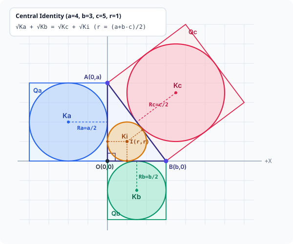

# Лаборатория математических кругов Пифагора — Каноническая геометрическая лаборатория

**English Title:** *Pythagoras Circles — Canonical Geometry Research Laboratory*  
**Предлагаемое имя GitHub-репозитория:** `pythagoras-circles-canon-geometry-lab` · **Версия:** `1.2.0` · **Лицензия:** [MIT](LICENSE)

*Интерактивная математико-геометрическая лаборатория для исследования теоремы Пифагора, вписанной и описанной окружностей, разбиения инцентром и параметрического спектрального анализа.*

[English Version (`README.md`)](README.md) · [Каноническая документация](docs/canonical/README.md) · [Канонический обзор](docs/canonical/01_CANONICAL_OVERVIEW.md) · [Математическая модель](docs/canonical/02_CANONICAL_MATHEMATICAL_MODEL.md) · [Архитектура](docs/canonical/05_CANONICAL_ARCHITECTURE.md) · [Паспорта формул (`F01`–`F19`)](docs/canonical/formula-passports/README.md) · [Аудит перед публикацией (Stage 7.2)](docs/canonical/pre-publication-audit/README.md)

---

## 1. Обзор проекта

**Лаборатория математических кругов Пифагора — Каноническая геометрическая лаборатория** (`Pythagoras Circles — Canonical Geometry Research Laboratory`, репозиторий `pythagoras-circles-canon-geometry-lab`) — интерактивный математико-геометрический стенд на базе React, TypeScript и Vite, в котором все построения и вычисления детерминированно рассчитываются от геометрии евклидова прямоугольного треугольника:

- прямоугольный треугольник ($\triangle ABC$ в канонической системе с именованием сторон по противоположным вершинам; $\triangle OAB$ в координатах интерфейса),
- три внешних квадрата на его сторонах ($Q_a, Q_b, Q_c$),
- три окружности, вписанные в эти квадраты ($K_a, K_b, K_c$),
- вписанная окружность треугольника ($K_i$) с центром в инцентре $I(r, r)$,
- **разбиение треугольника через инцентр** на три внутренних треугольника с общей высотой $r$ ($S = S_A + S_B + S_C = p \cdot r$),
- **описанная окружность Фалеса ($K_o$)** с диаметром на гипотенузе,
- **параметрический спектральный анализ** по безразмерному параметру формы ($\rho = \text{sideA}/\text{sideB}$ или $t = b/a$) и закону однородного масштабирования ($\lambda = c/5$),
- шесть экспериментальных модулей анализа дуг и инциркла (**Эксперименты 01–06**).

---

## 2. Ключевые математические идеи и согласование двух нотаций

### 2.1 Центральное тождество четырёх кругов и контраст площадей
Теорема Пифагора для внешних квадратов индуцирует равенство площадей квадратных кругов $K_a + K_b = K_c$. Добавление вписанного круга $K_i$ выявляет точное **линейно-масштабное тождество для квадратных корней из площадей**, выполняющееся для любого невырожденного прямоугольного треугольника:

$$\sqrt{\operatorname{Area}(K_a)} + \sqrt{\operatorname{Area}(K_b)} = \sqrt{\operatorname{Area}(K_c)} + \sqrt{\operatorname{Area}(K_i)}$$

При этом прямая сумма площадей даёт строго отрицательную невязку:

$$\operatorname{Area}(K_a) + \operatorname{Area}(K_b) - \operatorname{Area}(K_c) - \operatorname{Area}(K_i) = -\operatorname{Area}(K_i) < 0$$

### 2.2 Тождество разбиения через инцентр
Соединение инцентра $I(r, r)$ с тремя вершинами разбивает прямоугольный треугольник на три внутренних треугольника с общей высотой $r$:

$$S = S_A + S_B + S_C = p \cdot r, \qquad p = \frac{a + b + c}{2}, \qquad r = \frac{ab}{a + b + c} = \frac{a + b - c}{2}$$

### 2.3 Канонический стандарт (`CANONICAL_OPPOSITE_SIDE_V1`) и модель интерфейса
В кодовой базе используются две алгебраически изоморфные системы обозначений, явно связанные в модуле [`src/canonical/legacyMapping.ts`](src/canonical/legacyMapping.ts) (точность согласования $\le 10^{-12}$):

| Величина | Каноническое ядро (`src/canonical/canonicalFourCircles.ts`) | Модель UI (`src/math/FourCirclesModel.ts`, `IncenterPartition.ts`) | Эквивалентность |
| :--- | :--- | :--- | :--- |
| Вершина прямого угла | $C = (0, 0)$ ($\gamma = 90^\circ$) | $O = (0, 0)$ (в `IncenterPartition.ts` обозначена `C`) | Общее начало координат |
| Вершины $A, B$ | $A = (0, \text{sideB})$, $B = (\text{sideA}, 0)$ | $A = (0, a)$, $B = (b, 0)$ | $\text{sideA} \equiv b,\; \text{sideB} \equiv a$ |
| Правило имён катетов | По противоположной вершине: `sideA` $= |BC|$, `sideB` $= |AC|$ | По координатной оси: `a` $= |OA|$, `b` $= |OB|$ | Явный перенос имён |
| Параметр формы | $\rho = \text{sideA} / \text{sideB} = \tan\alpha$ | $t = b / a$ | $\rho \equiv t$ |
| Подобласти $S_A, S_B$ | $S_A^{\text{canon}} = \frac{1}{2}\text{sideA}\cdot r$ ($\triangle IBC$), $S_B^{\text{canon}} = \frac{1}{2}\text{sideB}\cdot r$ ($\triangle IAC$) | `SA` $= \frac{1}{2}a r$ ($\triangle CAI$), `SB` $= \frac{1}{2}b r$ ($\triangle CBI$) | `SA` $\equiv S_B^{\text{canon}}$, `SB` $\equiv S_A^{\text{canon}}$ |

*(Примечание: Эксперимент 06 в [`src/math/experiments/arcSideAreaCorrespondence.ts`](src/math/experiments/arcSideAreaCorrespondence.ts) использует каноническую индексацию по противолежащим сторонам: $S_a = \frac{1}{2}|OB|r$, $S_b = \frac{1}{2}|OA|r$, $S_c = \frac{1}{2}|AB|r$.)*

### 2.4 Сводка геометрических слоёв (`CANONICAL_OPPOSITE_SIDE_V1`)



| Круг | Геометрическое построение | Центр (`CANONICAL_OPPOSITE_SIDE_V1`) | Радиус | Площадь |
| :--- | :--- | :--- | :--- | :--- |
| **$K_a$** | Вписан в квадрат $Q_a$ на стороне $BC$ (`sideA`) | $\left(\frac{\text{sideA}}{2},\; -\frac{\text{sideA}}{2}\right)$ | $\frac{\text{sideA}}{2}$ | $\frac{\pi \cdot \text{sideA}^2}{4}$ |
| **$K_b$** | Вписан в квадрат $Q_b$ на стороне $AC$ (`sideB`) | $\left(-\frac{\text{sideB}}{2},\; \frac{\text{sideB}}{2}\right)$ | $\frac{\text{sideB}}{2}$ | $\frac{\pi \cdot \text{sideB}^2}{4}$ |
| **$K_c$** | Вписан в квадрат $Q_c$ на гипотенузе $AB$ (`sideC`) | $\left(\frac{\text{sideA}+\text{sideB}}{2},\; \frac{\text{sideA}+\text{sideB}}{2}\right)$ | $\frac{\text{sideC}}{2}$ | $\frac{\pi \cdot \text{sideC}^2}{4}$ |
| **$K_i$** | Вписанная окружность $\triangle ABC$ | $(r,\; r)$ | $r = \frac{\text{sideA}\cdot\text{sideB}}{\text{sideA}+\text{sideB}+\text{sideC}}$ | $\pi r^2$ |
| **$K_o$** | Окружность Фалеса через $A, B, C$ (диаметр $AB$) | $\left(\frac{\text{sideA}}{2},\; \frac{\text{sideB}}{2}\right)$ | $\frac{\text{sideC}}{2}$ | $\frac{\pi \cdot \text{sideC}^2}{4}$ |

Окружности $K_c$ и $K_o$ обладают одинаковыми диаметром, радиусом, площадью и длиной окружности, при этом их центры разнесены на расстояние $|O_o - O_c| = \text{sideC}/2 > 0$.

---

## 3. Модули приложения и интерактивные возможности

Рабочая среда (`src/App.tsx`, `src/components/common/Header.tsx`) включает **9 аналитических модулей** и интерактивный слой **разбиения через инцентр**:

1. `01. Четыре круга` (`four_circles`) — полная сцена треугольника, $Q_a, Q_b, Q_c$, $K_a, K_b, K_c, K_i$ и сопоставление $K_c$ с $K_o$.
2. `02. Тождество √K` (`identity_proof`) — алгебраическая и численная проверка $\sqrt{K_a} + \sqrt{K_b} = \sqrt{K_c} + \sqrt{K_i}$.
3. `03. Вписанный круг Kᵢ` (`incircle_focus`) — сфокусированный анализ $K_i$, инцентра $I$ и точек касания $T_a, T_b, T_c$.
4. `04. Спектральный анализ` (`spectral_analysis`) — интерактивный график (`SpectralAnalysisPanel.tsx`) с пятью модельными режимами: **Площади**, **Периметры**, **Радиусы/Диаметры**, **Рост $K_o(t)$** и **Масштаб $\lambda$** (законы однородности $L \propto \lambda^1$, $K \propto \lambda^2$), с логарифмической/линейной шкалой, анимацией симметрии и двусторонней синхронизацией с холстом.
5. `05. Окружность Фалеса Kₒ` (`thales_circumcircle`) — проверка $\angle AOB = 90^\circ$, равноудалённости вершин, масштаба $\lambda$ и трёх центров ($I, O_o, O_c$).
6. `06. Дуга и классификация` (`arc_classification`) — **Эксперименты 01 и 02**: построение от инциркла $(r, t)$ и дискретизация четверть-дуги.
7. `07. Дуга и углы` (`arc_angle_analysis`) — **Эксперименты 03 и 04**: валидация касательных, перетаскивание точки касания $T_{AB}$ и анализ угловых зон.
8. `08. Три дуги Kᵢ` (`incircle_arc_distribution`) — **Эксперимент 05**: распределение центральных дуг $\varphi_A, \varphi_B, \varphi_C$ ($\varphi_A + \varphi_B + \varphi_C = 2\pi$).
9. `09. Дуга–Сторона–Площадь` (`arc_side_area`) — **Эксперимент 06**: изоморфизм дуг инциркла, сторон и площадей разбиения (`L-01`–`L-07`).

**Дополнительные возможности:**
- **Разбиение через инцентр (`IncenterPartitionOverlay.tsx`, `IncenterPartitionControls.tsx`):** SVG-разбиение, 7-шаговое доказательство $S = S_A + S_B + S_C = pr$ и числовая таблица. *(Ограничение: подписи в `IncenterPartitionControls.tsx` и `IncenterPartitionSpectralPanel.tsx` жёстко заданы на русском языке, а `IncenterPartitionSpectralPanel.tsx` рисует статические иллюстративные кривые Безье и фиксированную подпись `(Δ = 0.000)`; см. [Аудит перед публикацией Stage 7.2](docs/canonical/pre-publication-audit/README.md).)*
- **17 живых инвариантов (`InvariantsPanel.tsx`, `TestRunnerModal.tsx`):** 8 базовых инвариантов и 9 инвариантов окружности Фалеса (`validateAllFiveCirclesInvariants`, допуск $10^{-9}$).
- **Локализация `RU / UK / EN` (`src/i18n/translations.ts`):** перевод основных меню, панелей, подсказок на сцене и атрибута `<html lang>`.
- **Пресеты, Undo/Redo, сравнение и экспорт:** контрольные треугольники `(3,4,5)`, `(5,12,13)`, `(4,4,4√2)`, `(1,10,√101)`, `(10,1,√101)`, `(8,15,17)`, модальное сравнение, JSON, пошаговая анимация, PNG/SVG.

---

## 4. Архитектура и структура репозитория

```text
.
├── docs/
│   ├── canonical/                              # Нормативный канонический пакет документации
│   │   ├── README.md                           # Индекс канонической документации
│   │   ├── 01_CANONICAL_OVERVIEW.md            # Идентичность, цели, 9 модулей, границы
│   │   ├── 02_CANONICAL_MATHEMATICAL_MODEL.md  # Согласованная математическая модель и Exp 01–06
│   │   ├── 03_CANONICAL_NOTATION_STANDARD.md   # Стандарт CANONICAL_OPPOSITE_SIDE_V1
│   │   ├── 04_CANONICAL_INTERNAL_TRIANGLE_NAMING.md # Спецификация имён S_A, S_B, S_C
│   │   ├── 05_CANONICAL_ARCHITECTURE.md        # Верифицированная структура исходного кода
│   │   ├── 06_CANONICAL_SPECTRAL_ANALYSIS.md   # Спектральные графики и аудит субпанели инцентра
│   │   ├── 07_CANONICAL_INTERACTION_MODEL.md   # Перетаскивание, курсоры, зум и экспорт
│   │   ├── 08_CANONICAL_VERIFICATION_AND_TESTS.md # Реестр всех 16 тестовых файлов
│   │   ├── 09_CANONICAL_DATA_FLOW.md           # Детерминированный поток данных от App.tsx
│   │   ├── 10_CANONICAL_GLOSSARY.md            # Канонический словарь терминов
│   │   ├── 11_CANONICAL_CHANGELOG.md           # История изменений канонического контура
│   │   ├── formula-passports/                  # Паспорта формул (модель UMFP, F01–F19)
│   │   │   ├── README.md
│   │   │   ├── FORMULA_INVENTORY.md
│   │   │   ├── FORMULA_DEPENDENCY_GRAPH.md
│   │   │   ├── notation/NOTATION_PROFILE.md
│   │   │   ├── audit/AUDIT_REPORT.md
│   │   │   └── passports/F01_HYPOTENUSE.md ... F19_ASPECT_RATIO.md
│   │   └── pre-publication-audit/              # Пакет аудита перед публикацией (Stage 7.2)
│   │       ├── README.md
│   │       ├── STAGE_7_2_PRE_PUBLICATION_AUDIT.md
│   │       └── VERIFICATION_MATRIX.md
│   └── ...                                     # Историческая (Legacy) документация (сохранена)
├── src/
│   ├── canonical/                              # Чистое каноническое ядро (opposite-side)
│   ├── math/                                   # Расчётное ядро UI и experiments/ (Exp 01–06)
│   ├── geometry/transforms.ts                  # Декартовы <-> экранные SVG-координаты
│   ├── i18n/translations.ts                    # Словари RU / UK / EN
│   ├── types/geometry.ts                       # Типы и объединение 9 модулей
│   ├── components/                             # UI-компоненты React (common/, geometry/, panels/)
│   ├── tests/                                  # 16 исполняемых тестовых файлов (+ testHelpers.ts)
│   ├── App.tsx                                 # Корневое состояние и оркестрация модулей
│   ├── index.css                               # Tailwind CSS v4 + стили KaTeX
│   └── main.tsx                                # Точка входа React DOM
├── index.html                                  # HTML-точка входа и канонические метаданные
├── metadata.json                               # Дескриптор приложения
├── package.json                                # Метаданные, скрипты и зависимости
├── tsconfig.json                               # Конфигурация TypeScript
└── vite.config.ts                              # Конфигурация Vite 8
```

---

## 5. Навигация по канонической документации

- **Обзор:** [`docs/canonical/01_CANONICAL_OVERVIEW.md`](docs/canonical/01_CANONICAL_OVERVIEW.md)
- **Каноническая архитектура:** [`docs/canonical/05_CANONICAL_ARCHITECTURE.md`](docs/canonical/05_CANONICAL_ARCHITECTURE.md)
- **Математическая модель:** [`docs/canonical/02_CANONICAL_MATHEMATICAL_MODEL.md`](docs/canonical/02_CANONICAL_MATHEMATICAL_MODEL.md)
- **Стандарт нотации и внутренние треугольники:** [`docs/canonical/03_CANONICAL_NOTATION_STANDARD.md`](docs/canonical/03_CANONICAL_NOTATION_STANDARD.md) · [`docs/canonical/04_CANONICAL_INTERNAL_TRIANGLE_NAMING.md`](docs/canonical/04_CANONICAL_INTERNAL_TRIANGLE_NAMING.md)
- **Спектральный анализ и специальный аудит:** [`docs/canonical/06_CANONICAL_SPECTRAL_ANALYSIS.md`](docs/canonical/06_CANONICAL_SPECTRAL_ANALYSIS.md)
- **Паспорта формул (модель UMFP):** [`docs/canonical/formula-passports/README.md`](docs/canonical/formula-passports/README.md)
  - **Профиль нотации:** [`docs/canonical/formula-passports/notation/NOTATION_PROFILE.md`](docs/canonical/formula-passports/notation/NOTATION_PROFILE.md)
  - **Инвентарь формул (`F01`–`F19`):** [`docs/canonical/formula-passports/FORMULA_INVENTORY.md`](docs/canonical/formula-passports/FORMULA_INVENTORY.md)
  - **Граф зависимостей формул:** [`docs/canonical/formula-passports/FORMULA_DEPENDENCY_GRAPH.md`](docs/canonical/formula-passports/FORMULA_DEPENDENCY_GRAPH.md)
  - **Отчёт аудита паспортов формул:** [`docs/canonical/formula-passports/audit/AUDIT_REPORT.md`](docs/canonical/formula-passports/audit/AUDIT_REPORT.md)
- **Аудит Stage 7.2 перед публикацией и матрица верификации:** [`docs/canonical/pre-publication-audit/README.md`](docs/canonical/pre-publication-audit/README.md) · [`STAGE_7_2_PRE_PUBLICATION_AUDIT.md`](docs/canonical/pre-publication-audit/STAGE_7_2_PRE_PUBLICATION_AUDIT.md) · [`VERIFICATION_MATRIX.md`](docs/canonical/pre-publication-audit/VERIFICATION_MATRIX.md)

---

## 6. Установка, запуск, сборка и тестирование

**Требования:** Node.js (рекомендуется v18+) и `npm` (или `bun`).

```bash
npm install
npm run dev       # Запуск Vite dev-сервера на http://localhost:3000
npm run lint      # Статическая проверка типов TypeScript (tsc --noEmit)
npm run build     # Сборка production-версии в каталог dist/
npm test          # Запуск базовых автотестов (geometry.test.ts и incenterPartition.test.ts)
```

### Запуск полного набора из 16 тестовых файлов
По умолчанию команда `npm test` в `package.json` запускает только 2 из 16 тестовых файлов (`src/tests/geometry.test.ts` и `src/tests/incenterPartition.test.ts`). Для запуска всех 16 файлов выполните:

```bash
for f in src/tests/*.test.ts src/tests/canonical/*.test.ts; do npx tsx "$f"; done
```

Подробные результаты всех 16 проверок см. в [`docs/canonical/08_CANONICAL_VERIFICATION_AND_TESTS.md`](docs/canonical/08_CANONICAL_VERIFICATION_AND_TESTS.md) и [`docs/canonical/pre-publication-audit/VERIFICATION_MATRIX.md`](docs/canonical/pre-publication-audit/VERIFICATION_MATRIX.md).

---

## 7. Историческая (Legacy) документация

Ранние документы предыдущих этапов сохранены в каталоге [`/docs/`](docs/) для исторической прослеживаемости (`MATHEMATICAL_FOUNDATION.md`, `FORMULA_PASSPORTS.md` [`PCL-A01`–`PCL-G30`], `ARCHITECTURE.md`, `docs/experiments/`, `docs/audit/`, `docs/semantic-formula-passports/` и др.). При любых расхождениях между историческими и каноническими текстами нормативным источником для текущего кода является пакет **`docs/canonical/`**.

---

## 8. Лицензия и авторство

Распространяется по лицензии **MIT License** — см. [`LICENSE`](LICENSE).  
**Copyright (c) 2026 Andrey Artsybashev** — относится к оригинальному коду, архитектуре, интерактивной визуализации и документации репозитория и не претендует на авторство классических теорем евклидовой геометрии.
