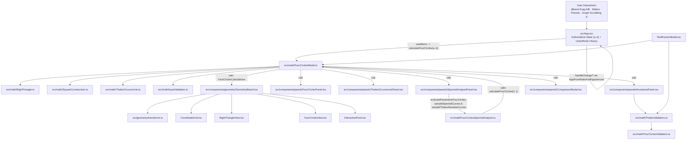

# Software Architecture — Four-Circles Pythagorean Geometry Lab

This document describes the verified software architecture of the **Four-Circles Pythagorean Geometry Lab** (`src/`), reflecting all active TypeScript modules, React components, state synchronization flows, SVG visualization layers, and tests.

---

## 1. Architectural Overview & Data Flow

The application follows a **unidirectional deterministic calculation pipeline** driven by a single authoritative pair of positive leg lengths `(a, b)` managed in `src/App.tsx`, with bidirectional synchronization between the geometric scene and the parametric $t = b/a$ plot.

---

## 2. Entry Points & Configuration

- **`index.html`**: Root HTML document loading optional Google Fonts (`Plus Jakarta Sans`, `JetBrains Mono` as progressive enhancement over system fallbacks in `src/index.css`) and mounting `#root` and `/src/main.tsx`.
- **`src/main.tsx`**: React 19 `createRoot` entry point importing `katex/dist/katex.min.css` (bundled locally alongside KaTeX font assets by Vite), `src/App.tsx`, and `src/index.css`.
- **`src/index.css`**: Tailwind CSS v4 entry (`@import "tailwindcss";`).
- **`vite.config.ts`**: Vite 8 configuration with `@vitejs/plugin-react`, `@tailwindcss/vite`, `@` path alias, and conditional HMR toggle (`DISABLE_HMR`).
- **`tsconfig.json`**: ES2022/ESNext bundler TypeScript configuration (`allowImportingTsExtensions`, `noEmit`).

---

## 3. Mathematical Core (`src/math/`)

All files in `src/math/` are pure TypeScript functions free of React or DOM side effects, corresponding to the formal UMFP specification in [`FORMULA_PASSPORTS.md`](FORMULA_PASSPORTS.md) and [`FORMULA_DEPENDENCY_GRAPH.md`](FORMULA_DEPENDENCY_GRAPH.md):

| File | Responsibility | Key Exports | UMFP Passports |
|---|---|---|---|
| `inputValidation.ts` | Positive finite domain guard | `InvalidTriangleInputError`, `assertValidLeg`, `assertValidLegs` | `PCL-A01` |
| `RightTriangle.ts` | Right triangle vertices, hypotenuse (`Math.hypot`), angles, area, altitude | `calculateRightTriangle` | `PCL-A02`–`PCL-A04` |
| `SquareConstruction.ts` | Exterior squares $Q_a, Q_b, Q_c$ coordinates and areas | `calculateSquareA`, `calculateSquareB`, `calculateSquareC`, `getUniversalDirectionVector` | `PCL-B05`–`PCL-B07` |
| `ThalesCircumcircle.ts` | Fifth layer $K_o$: circumcenter $(A+B)/2$ from endpoints, $D_o, R_o, K_o, L_o$, equidistance, inscribed $90^\circ$ angle, $K_c$ contrast | `calculateThalesCircumcircleFromVertices`, `calculateThalesCircumcircle` | `PCL-G25`–`PCL-G28` |
| `FourCirclesModel.ts` | Complete 4-circle + $K_o$ model ($K_a, K_b, K_c, K_i, K_o$), tangency points, $\sqrt{K}$ identity, area contrast | `calculateFourCircles` | `PCL-C08`–`PCL-E17`, `PCL-G25`–`PCL-G28` |
| `FourCirclesValidators.ts` | 8 core scale-normalized invariants (tolerance `1e-9`) | `validateFourCirclesInvariants` | `PCL-B06`, `PCL-C09`–`PCL-E17` |
| `ThalesValidators.ts` | 9 Thales $K_o$ invariants and 17-invariant combined validator | `validateThalesCircumcircleInvariants`, `validateAllFiveCirclesInvariants` | `PCL-G25`–`PCL-G28` |
| `FourCirclesSpectralAnalysis.ts` | Current-state ratios (core 4 + `circumcircleItem`), parametric $t = b/a$ curve evaluator & samplers (including `thalesNorm`, `thalesAbs`), $t \to (a, b)$ mapping | `computeFourCirclesSpectralAnalysis`, `evaluateParametricFourCircles`, `sampleSpectralCurves`, `sampleThalesAbsoluteCurves`, `getNormalizedValuesForMode`, `getThalesNormalizedValueForMode`, `legsFromRatioAndHypotenuse`, `REFERENCE_T_VALUES`, `CIRCLE_SERIES_META`, `THALES_SERIES_META` | `PCL-F18`–`PCL-F24`, `PCL-G29` |
| `symmetryAnimation.ts` | Pure elapsed-time logarithmic trajectory $t_{\text{start}} \to 1/t_{\text{start}} \to t_{\text{start}}$ and $t = 1$ axis check | `evaluateSymmetryTrajectoryT`, `isAtSymmetryAxis`, `easeInOutCubic`, `SYMMETRY_ANIMATION_DURATION_MS` | — |
| `presets.ts` | Built-in benchmark triangles | `FOUR_CIRCLES_PRESETS` | — |

---

## 4. Coordinate Transforms, Types & Localization

- **`src/types/geometry.ts`**: Strongly typed interfaces (`Point2D`, `RightTriangleCalculations`, `SquareVertices`, `HypotenuseSquareVertices`, `CircleInSquareGeometry`, `TriangleIncircleGeometry`, `ThalesCircumcircleGeometry`, `FourCirclesCalculations`, `InvariantValidation`, `PresetConfiguration`, `ActiveModuleId`, `DisplayMode`, `BoardLayerFilter`, `HoveredObject`, `SavedConfiguration`).
- **`src/geometry/transforms.ts`**: Converts between mathematical Cartesian coordinates (origin-centered, $+y$ up) and SVG viewport pixel coordinates ($+y$ down) via `toScreen`, `toMath`, and `formatPoint`.
- **`src/i18n/translations.ts`**: Complete `ru`, `uk`, and `en` UI dictionary powering `Header`, `BottomToolbar` (including Load popover and status messages), `GeometryBoard`, `FourCirclesView`, `RightTriangleView`, `InteractivePoint` hover inspection tooltips, `ControlsPanel` (with preset descriptions keyed by `preset.id`), `FourCirclesPanel`, `ThalesCircumcirclePanel`, `KcVsKoComparison`, `SpectralAnalysisPanel`, `InvariantsPanel` (keyed by invariant ID), `ComparisonModal`, `TestRunnerModal`, and `HelpModal`. Switching language in `App.tsx` also updates `document.documentElement.lang`.

---

## 5. React Component Architecture (`src/components/`)

### Common UI (`src/components/common/`)
- **`Header.tsx`**: Top navigation bar switching between the five `ActiveModuleId` tabs (`four_circles`, `identity_proof`, `incircle_focus`, `spectral_analysis`, `thales_circumcircle`) and opening Compare, Tests (`17/17`), and Help modals.
- **`BottomToolbar.tsx`**: Undo/Redo (`Ctrl+Z`/`Ctrl+Y`), Reset `(4, 3)`, `localStorage` configuration save/load (`pythagoras_four_circles_configs_v1`) + JSON file export/import, PNG/SVG snapshot export, step-by-step layer animation trigger (`triangle_incircle -> squares -> square_circles -> thales_only -> five_circles -> all`), `RU/UK/EN` switcher, and Help button.
- **`MathFormula.tsx`**: Memoized KaTeX HTML renderer (`katex.renderToString`).
- **`MetricCard.tsx`**: Tabular-numeral metric readout card.

### SVG Geometry Visualization (`src/components/geometry/`)
- **`GeometryBoard.tsx`**: Interactive SVG canvas handling pointer dragging of vertex $A(0, a)$ along $+y$, vertex $B(b, 0)$ along $+x$, background panning, wheel/button zooming, fit-to-view, layer filter buttons (`all`, `triangle_incircle`, `squares`, `square_circles`, `four_circles_only`, `thales_only`, `five_circles`), `K_o` circumcircle toggle, and display toggles (grid, labels, centers, radii, angles).
- **`CoordinateGrid.tsx`**: Adaptive Cartesian coordinate grid and axis ticks.
- **`RightTriangleView.tsx`**: Renders $\triangle OAB$, right-angle square at $O$, angle arcs $\alpha, \beta$, and altitude $h_c$.
- **`FourCirclesView.tsx`**: Renders $Q_a, Q_b, Q_c$, $K_a, K_b, K_c, K_i$, and the dashed violet Thales circumcircle $K_o$ (using stroke-hit perimeter so interior circles remain hoverable), centers $O_a, O_b, O_c, I, O_o$, radii, tangency points $T_a, T_b, T_c$, and Thales focus highlights ($AB$ diameter, $O_oO$ median, vertex rings).
- **`InteractivePoint.tsx`**: Draggable SVG control handles for vertices $A$ and $B$.

### Analytical Panels & Modals (`src/components/panels/`)
- **`ControlsPanel.tsx`**: Numeric inputs and range sliders (`[0.5, 12]`) for $a$ and $b$, preset buttons, and continuous `requestAnimationFrame` parametric sweep.
- **`FourCirclesPanel.tsx`**: Visual/Research mode switch, central $\sqrt{K}$ identity LHS/RHS/residual cards, contextual proof/incircle notes, summary circle table (including $K_o$), embedded `<KcVsKoComparison />`, area contrast cards, and collapsible coordinates.
- **`ThalesCircumcirclePanel.tsx`**: Dedicated Module `05` view summarizing Thales' theorem, metrics $D_o, R_o, K_o, L_o$, live equidistance checks ($|O_o-A|, |O_o-B|, |O_o-O|$) and $\angle AOB = 90^\circ$, 3-center comparison ($I$ vs. $O_o$ vs. $O_c$), and `<KcVsKoComparison />`.
- **`KcVsKoComparison.tsx`**: Reusable side-by-side table comparing $K_c$ vs. $K_o$ (role, centers, diameter, radius, area, circumference, coincident vertices) and live difference cards ($|K_o - K_c| = 0$, $|O_o - O_c| = c/2$).
- **`SpectralAnalysisPanel.tsx`**: Interactive SVG Cartesian plot (`viewBox="0 0 640 300"`) for module `04. Спектральный анализ`. Plots four normalized curves vs. $t = b/a$, optional constant $K_o$ overlay, and an `Abs. Growth K_o(t)` tab plotting unnormalized $R_o^*, D_o^*, L_o^*, K_o^*$ for $a=1, b=t$. Includes pointer scrubbing, `log` / `linear` X-axis toggle, zoom/reset, symmetry sweep animation, reference $t$ cards, live `(a, b)` vs. `(1, t)` vs. ratio table, 5-circle readout table, and collapsible share bars.
- **`InvariantsPanel.tsx`**: Live display of all 17 `validateAllFiveCirclesInvariants(calc)` checks grouped under Core Four Circles (`8/8`) and Thales Circumcircle (`9/9`).
- **`ComparisonModal.tsx`**: Side-by-side 5-circle miniature SVG & numeric comparison (including $R_o, K_o$) against a saved/benchmark triangle.
- **`TestRunnerModal.tsx`**: Interactive runner displaying 17-invariant results and $r, R_o$ metrics for 5 built-in control triangles with 1-click loading onto the board.
- **`HelpModal.tsx`**: Reference modal summarizing all 5 circles ($K_a, K_b, K_c, K_i, K_o$), the $\sqrt{K}$ identity, and the $K_o = K_c$ / $O_o \neq O_c$ contrast.

---

## 6. State Management & Synchronization (`src/App.tsx`)

- **Authoritative State:** `a` (default `4`) and `b` (default `3`) in `App.tsx`, clamped via `clampVal` to `[0.2, 15]` rounded to 6 decimal places (`1e-6`), with a 40-entry Undo/Redo history stack and stable callback refs so continuous sweeps never recreate animation effects.
- **Forward Flow:** `calculateFourCircles(a, b)` runs inside `useMemo`, feeding `GeometryBoard`, `ControlsPanel`, `FourCirclesPanel`, `ThalesCircumcirclePanel`, `SpectralAnalysisPanel`, `InvariantsPanel`, and `ComparisonModal`.
- **Reverse Flow from Graph ($t \to (a, b)$):** When the user scrubs the parametric SVG graph, clicks a reference $t$ card, or runs the symmetry sweep in `SpectralAnalysisPanel`, `onChangeT(targetT, recordHistory, fixedHypotenuse, fromSymmetryAnimation)` calls `legsFromRatioAndHypotenuse(targetT, referenceC, 0.2, 15)` to compute $(a, b)$ preserving $b/a = t$ and keeping hypotenuse $c$ steady (within leg bounds `[0.2, 15]`). Because `App.tsx` updates `(a, b)`, the geometry board, sliders, invariant panel, graph cursor, and readout table stay strictly synchronized without duplicate state.

---

## 7. Test Architecture (`src/tests/geometry.test.ts`)

- Executed directly via `tsx src/tests/geometry.test.ts` (`npm test`) using Node's `node:assert/strict`.
- Covers 9 test sections: control triangles, leg-swap symmetry, invalid input rejection, micro/macro/extreme aspect ratio stability (`1e-6` to `1e50`), mutation (fault-injection) tests for validators, current-state spectral analysis, parametric graph & synchronization verification for $t \in \{0.1, 0.5, 1.0, 2.0, 10.0\}$, regression checks for $t \leftrightarrow 1/t$ reciprocal symmetry & smooth log trajectories, and Section 9 Thales Circumcircle ($K_o$) & Five-Circle integration verification (including shifted/rotated general right triangles and monotonic growth).
