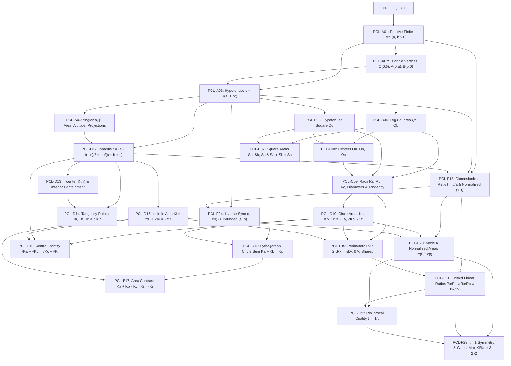

# Formula Dependency Graph — Four-Circles Pythagorean Geometry Lab (PCL)

This document traces the exact logical and computational derivation graph of all 24 UMFP formula passports (`PCL-A01` – `PCL-F24`) defined in [`FORMULA_PASSPORTS.md`](FORMULA_PASSPORTS.md).

The graph shows how the two independent leg parameters $(a, b)$ split into two geometric branches — exterior squares with their inscribed circles (Groups B–C) and the triangle incircle (Group D) — before converging in the central $\sqrt{K}$ identity (Group E) and the dimensionless parametric $t = b/a$ system (Group F).

---

## 1. Derivation Directed Acyclic Graph (DAG)

---

## 2. Structural Reading of the Graph

1. **Axiomatic Root (`PCL-A01` – `PCL-A04`):**
   Everything is derived from finite positive legs $(a, b)$. The hypotenuse $c = \sqrt{a^2+b^2}$ (`PCL-A03`) is the sole nonlinear root dependency feeding both branches.
2. **Exterior Squares & Square-Inscribed Circles (`PCL-B05` – `PCL-C11`):**
   Squares $Q_a, Q_b, Q_c$ determine diameters $(a, b, c)$, centers, areas $K_a, K_b, K_c$, and the quadratic Pythagorean sum $K_a + K_b = K_c$ (`PCL-C11`).
3. **Triangle Incircle (`PCL-D12` – `PCL-D15`):**
   Using $c$ and $(a, b)$, the inradius $r = \frac{ab}{a+b+c} = \frac{a+b-c}{2}$ (`PCL-D12`) yields the incenter $I(r,r)$, tangency points $T_a, T_b, T_c$, area $K_i$, and root $\sqrt{K_i}$.
4. **Central Convergence (`PCL-E16` – `PCL-E17`):**
   `PCL-C10` and `PCL-D15` combine linearly via square roots in the Central Four-Circle Identity $\sqrt{K_a} + \sqrt{K_b} = \sqrt{K_c} + \sqrt{K_i}$ (`PCL-E16`), while `PCL-C11` and `PCL-D15` explain why direct areas fail to equate by exactly $-K_i$ (`PCL-E17`).
5. **Parametric Dependency & Non-Redundancy (`PCL-F18` – `PCL-F24`):**
   Setting $t = b/a$ (`PCL-F18`) produces quadratic area ratios (`PCL-F20`) and linear normalized ratios (`PCL-F21`). Crucially, `PCL-F21` explicitly shows that normalized perimeters ($P_x/P_c$), radii ($R_x/R_c$), and diameters ($D_x/D_c$) are **not independent laws** — they share a single derived node because $P_x = 2\pi R_x = \pi D_x$. Symmetry at $t = 1$ and its global maximum (`PCL-F23`) follow directly from reciprocal duality (`PCL-F22`), while `PCL-F24` maps interactive graph scrubbing back to bounded legs $(a, b)$.
