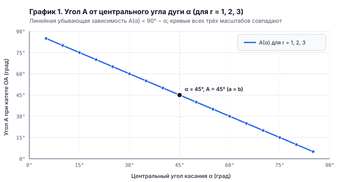
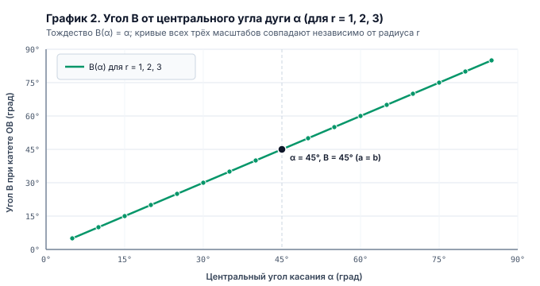
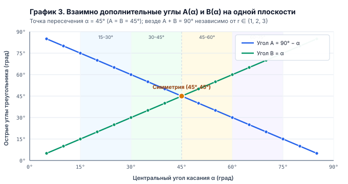
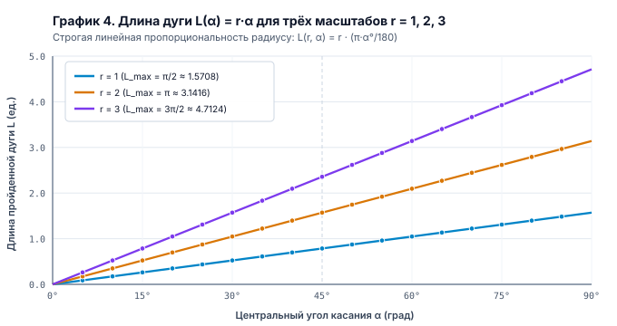
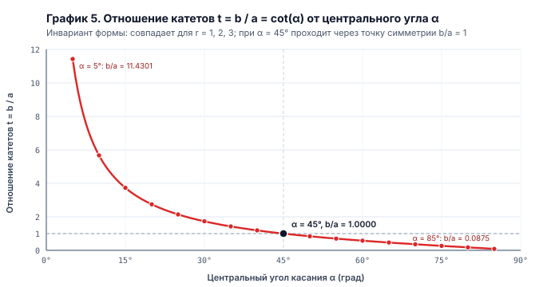

# EXPERIMENT 04 — ARC–ANGLE PARAMETRIC ANALYSIS

**Проект:** `Pythagoras-Circles-Lab`  
**Математический модуль:** `src/math/experiments/arcAngleParametricAnalysis.ts`  
**Тестовая верификация:** `src/tests/experiment04.arcAngle.test.ts`  
**Вкладка интерфейса лаборатории:** `07. Дуга и углы` (`ArcAngleAnalysisPanel` + `ArcAngleBoardOverlay`)  
**Графики (SVG):** `docs/experiments/figures/exp04_chart1_angle_a.svg` … `exp04_chart5_leg_ratio.svg`

---

## 1. Цель эксперимента и ответ на вопрос о смысле углов $A$ и $B$

Эксперимент исследует совместную параметрическую связь между:
- радиусом вписанной окружности $r \in \{1, 2, 3\}$;
- длиной пройденной дуги $L$ вписанной окружности $K_i$, по которой движется точка касания гипотенузы $T_{AB}$;
- острым углом $A$ между первым (вертикальным) катетом $OA$ и гипотенузой $AB$;
- острым углом $B$ между вторым (горизонтальным) катетом $OB$ и гипотенузой $AB$.

### Ответ на вопрос №4 о геометрическом смысле углов $A$ и $B$
Подтверждается **вариант А**: углы $A$ и $B$ — это **непосредственные внутренние острые углы прямоугольного треугольника $\triangle OAB$ между гипотенузой и двумя катетами**:
$$\angle A = \angle OAB = \arctan\frac{b}{a}, \qquad \angle B = \angle OBA = \arctan\frac{a}{b}, \qquad \angle A + \angle B = 90^\circ.$$
При этом имеет место точное геометрическое соответствие с **вариантом Б** (по теореме об углах со взаимно перпендикулярными сторонами): поскольку радиус касания $I T_{AB}$ перпендикулярен гипотенузе $AB$, а вертикальный радиус $IN$ перпендикулярен горизонтальному катету $OB$, угол поворота радиус-вектора $I \to T_{AB}$ от $N=(r, 2r)$ по часовой стрелке равен $\alpha \equiv \angle B$, а дополнение до $90^\circ$ (от $E=(2r, r)$ против часовой стрелки) равно $90^\circ - \alpha \equiv \angle A$.

---

## 2. Геометрическая модель и фиксация системы координат

Конструкция полностью согласована с `Experiment 01–03` (существующие модули не изменялись):

1. Окружность $K_i$ радиуса $r > 0$ имеет центр в точке $I = (r, r)$.
2. Первый катет $OA$ фиксирован вдоль положительной полуоси $Oy$ ($x = 0, y \ge 0$), точка касания $T_{OA} = (0, r)$.
3. Второй катет $OB$ фиксирован вдоль положительной полуоси $Ox$ ($y = 0, x \ge 0$), точка касания $T_{OB} = (r, 0)$.
4. Подвижная касательная (гипотенуза $AB$) касается $K_i$ в точке $T_{AB}$ на допустимой четверти окружности в первом квадранте от $N = (r, 2r)$ ($\alpha = 0^\circ$) по часовой стрелке до $E = (2r, r)$ ($\alpha = 90^\circ$):
   $$T_{AB}(\alpha) = \big(r(1 + \sin\alpha),\; r(1 + \cos\alpha)\big), \qquad L(\alpha) = r\alpha\;\text{(рад)}.$$
5. Прямая касательной задаётся уравнением $x\sin\alpha + y\cos\alpha = r(1 + \sin\alpha + \cos\alpha)$ и при $\alpha \in (0^\circ, 90^\circ)$ пересекает неподвижные оси в вершинах $A = (0, a)$ и $B = (b, 0)$:
   $$a(\alpha) = \frac{r(1 + \sin\alpha + \cos\alpha)}{\cos\alpha}, \qquad b(\alpha) = \frac{r(1 + \sin\alpha + \cos\alpha)}{\sin\alpha}, \qquad c(\alpha) = \frac{r(1 + \sin\alpha + \cos\alpha)}{\sin\alpha\cos\alpha}.$$

*(Примечание: при $\alpha = 0^\circ$ касательная $y = 2r$ параллельна оси $Ox$, а при $\alpha = 90^\circ$ касательная $x = 2r$ параллельна оси $Oy$; эти граничные положения вырождены и исключены из множества допустимых треугольников.)*

---

## 3–4. Масштабы и угловая дискретизация

Расчёты выполнены для трёх масштабов: $r = 1$ (малый), $r = 2$ (средний), $r = 3$ (большой), на единой угловой сетке с шагом $\Delta\alpha = 5^\circ$.

- Внутри открытого интервала $(0^\circ, 90^\circ)$ лежит ровно **$17$ невырожденных узлов**: $\alpha \in \{5^\circ, 10^\circ, 15^\circ, \dots, 85^\circ\}$.
- Суммарно по трём радиусам получена **$51$ строка** невырожденных треугольников.
- Выделены шесть исследовательских диапазонов дуги: `10°–15°`, `15°–30°`, `30°–45°`, `45°–60°`, `60°–75°`, `75°–80°`.

---

## 5. Основная таблица результатов ($r = 1, 2, 3$; шаг $5^\circ$; $51$ точка)

| № | $r$ | Центральный угол $\alpha$ | Длина дуги $L$ | Угол $A$ | Угол $B$ | Катет $a$ | Катет $b$ | Гипотенуза $c$ |
|---|---|---|---|---|---|---|---|---|
| 1 | 1 | 5° | 0.0873 | 85.0000° | 5.0000° | 2.0913 | 23.9038 | 23.9951 |
| 2 | 1 | 10° | 0.1745 | 80.0000° | 10.0000° | 2.1918 | 12.4301 | 12.6218 |
| 3 | 1 | 15° | 0.2618 | 75.0000° | 15.0000° | 2.3032 | 8.5958 | 8.8990 |
| 4 | 1 | 20° | 0.3491 | 70.0000° | 20.0000° | 2.4281 | 6.6713 | 7.0994 |
| 5 | 1 | 25° | 0.4363 | 65.0000° | 25.0000° | 2.5697 | 5.5107 | 6.0804 |
| 6 | 1 | 30° | 0.5236 | 60.0000° | 30.0000° | 2.7321 | 4.7321 | 5.4641 |
| 7 | 1 | 35° | 0.6109 | 55.0000° | 35.0000° | 2.9210 | 4.1716 | 5.0926 |
| 8 | 1 | 40° | 0.6981 | 50.0000° | 40.0000° | 3.1445 | 3.7475 | 4.8920 |
| 9 | 1 | 45° | 0.7854 | 45.0000° | 45.0000° | 3.4142 | 3.4142 | 4.8284 |
| 10 | 1 | 50° | 0.8727 | 40.0000° | 50.0000° | 3.7475 | 3.1445 | 4.8920 |
| 11 | 1 | 55° | 0.9599 | 35.0000° | 55.0000° | 4.1716 | 2.9210 | 5.0926 |
| 12 | 1 | 60° | 1.0472 | 30.0000° | 60.0000° | 4.7321 | 2.7321 | 5.4641 |
| 13 | 1 | 65° | 1.1345 | 25.0000° | 65.0000° | 5.5107 | 2.5697 | 6.0804 |
| 14 | 1 | 70° | 1.2217 | 20.0000° | 70.0000° | 6.6713 | 2.4281 | 7.0994 |
| 15 | 1 | 75° | 1.3090 | 15.0000° | 75.0000° | 8.5958 | 2.3032 | 8.8990 |
| 16 | 1 | 80° | 1.3963 | 10.0000° | 80.0000° | 12.4301 | 2.1918 | 12.6218 |
| 17 | 1 | 85° | 1.4835 | 5.0000° | 85.0000° | 23.9038 | 2.0913 | 23.9951 |
| 18 | 2 | 5° | 0.1745 | 85.0000° | 5.0000° | 4.1826 | 47.8075 | 47.9901 |
| 19 | 2 | 10° | 0.3491 | 80.0000° | 10.0000° | 4.3835 | 24.8601 | 25.2436 |
| 20 | 2 | 15° | 0.5236 | 75.0000° | 15.0000° | 4.6065 | 17.1915 | 17.7980 |
| 21 | 2 | 20° | 0.6981 | 70.0000° | 20.0000° | 4.8563 | 13.3426 | 14.1989 |
| 22 | 2 | 25° | 0.8727 | 65.0000° | 25.0000° | 5.1394 | 11.0214 | 12.1608 |
| 23 | 2 | 30° | 1.0472 | 60.0000° | 30.0000° | 5.4641 | 9.4641 | 10.9282 |
| 24 | 2 | 35° | 1.2217 | 55.0000° | 35.0000° | 5.8420 | 8.3432 | 10.1852 |
| 25 | 2 | 40° | 1.3963 | 50.0000° | 40.0000° | 6.2890 | 7.4950 | 9.7840 |
| 26 | 2 | 45° | 1.5708 | 45.0000° | 45.0000° | 6.8284 | 6.8284 | 9.6569 |
| 27 | 2 | 50° | 1.7453 | 40.0000° | 50.0000° | 7.4950 | 6.2890 | 9.7840 |
| 28 | 2 | 55° | 1.9199 | 35.0000° | 55.0000° | 8.3432 | 5.8420 | 10.1852 |
| 29 | 2 | 60° | 2.0944 | 30.0000° | 60.0000° | 9.4641 | 5.4641 | 10.9282 |
| 30 | 2 | 65° | 2.2689 | 25.0000° | 65.0000° | 11.0214 | 5.1394 | 12.1608 |
| 31 | 2 | 70° | 2.4435 | 20.0000° | 70.0000° | 13.3426 | 4.8563 | 14.1989 |
| 32 | 2 | 75° | 2.6180 | 15.0000° | 75.0000° | 17.1915 | 4.6065 | 17.7980 |
| 33 | 2 | 80° | 2.7925 | 10.0000° | 80.0000° | 24.8601 | 4.3835 | 25.2436 |
| 34 | 2 | 85° | 2.9671 | 5.0000° | 85.0000° | 47.8075 | 4.1826 | 47.9901 |
| 35 | 3 | 5° | 0.2618 | 85.0000° | 5.0000° | 6.2739 | 71.7113 | 71.9852 |
| 36 | 3 | 10° | 0.5236 | 80.0000° | 10.0000° | 6.5753 | 37.2902 | 37.8654 |
| 37 | 3 | 15° | 0.7854 | 75.0000° | 15.0000° | 6.9097 | 25.7873 | 26.6969 |
| 38 | 3 | 20° | 1.0472 | 70.0000° | 20.0000° | 7.2844 | 20.0138 | 21.2983 |
| 39 | 3 | 25° | 1.3090 | 65.0000° | 25.0000° | 7.7091 | 16.5321 | 18.2412 |
| 40 | 3 | 30° | 1.5708 | 60.0000° | 30.0000° | 8.1962 | 14.1962 | 16.3923 |
| 41 | 3 | 35° | 1.8326 | 55.0000° | 35.0000° | 8.7629 | 12.5148 | 15.2777 |
| 42 | 3 | 40° | 2.0944 | 50.0000° | 40.0000° | 9.4335 | 11.2424 | 14.6760 |
| 43 | 3 | 45° | 2.3562 | 45.0000° | 45.0000° | 10.2426 | 10.2426 | 14.4853 |
| 44 | 3 | 50° | 2.6180 | 40.0000° | 50.0000° | 11.2424 | 9.4335 | 14.6760 |
| 45 | 3 | 55° | 2.8798 | 35.0000° | 55.0000° | 12.5148 | 8.7629 | 15.2777 |
| 46 | 3 | 60° | 3.1416 | 30.0000° | 60.0000° | 14.1962 | 8.1962 | 16.3923 |
| 47 | 3 | 65° | 3.4034 | 25.0000° | 65.0000° | 16.5321 | 7.7091 | 18.2412 |
| 48 | 3 | 70° | 3.6652 | 20.0000° | 70.0000° | 20.0138 | 7.2844 | 21.2983 |
| 49 | 3 | 75° | 3.9270 | 15.0000° | 75.0000° | 25.7873 | 6.9097 | 26.6969 |
| 50 | 3 | 80° | 4.1888 | 10.0000° | 80.0000° | 37.2902 | 6.5753 | 37.8654 |
| 51 | 3 | 85° | 4.4506 | 5.0000° | 85.0000° | 71.7113 | 6.2739 | 71.9852 |

---

## 6. Сводные таблицы угловых диапазонов

### Серия 1: $r = 1$ ($L_{\max} = \pi/2 \approx 1.5708$)

| Радиус $r$ | Интервал дуги $\alpha$ | Диапазон угла $A$ | Диапазон угла $B$ | Диапазон длины дуги $L$ |
|---|---|---|---|---|
| 1 | 10°–15° | 75°–80° | 10°–15° | 0.1745–0.2618 ($\Delta L = 0.0873$) |
| 1 | 15°–30° | 60°–75° | 15°–30° | 0.2618–0.5236 ($\Delta L = 0.2618$) |
| 1 | 30°–45° | 45°–60° | 30°–45° | 0.5236–0.7854 ($\Delta L = 0.2618$) |
| 1 | 45°–60° | 30°–45° | 45°–60° | 0.7854–1.0472 ($\Delta L = 0.2618$) |
| 1 | 60°–75° | 15°–30° | 60°–75° | 1.0472–1.3090 ($\Delta L = 0.2618$) |
| 1 | 75°–80° | 10°–15° | 75°–80° | 1.3090–1.3963 ($\Delta L = 0.0873$) |

### Серия 2: $r = 2$ ($L_{\max} = \pi \approx 3.1416$)

| Радиус $r$ | Интервал дуги $\alpha$ | Диапазон угла $A$ | Диапазон угла $B$ | Диапазон длины дуги $L$ |
|---|---|---|---|---|
| 2 | 10°–15° | 75°–80° | 10°–15° | 0.3491–0.5236 ($\Delta L = 0.1745$) |
| 2 | 15°–30° | 60°–75° | 15°–30° | 0.5236–1.0472 ($\Delta L = 0.5236$) |
| 2 | 30°–45° | 45°–60° | 30°–45° | 1.0472–1.5708 ($\Delta L = 0.5236$) |
| 2 | 45°–60° | 30°–45° | 45°–60° | 1.5708–2.0944 ($\Delta L = 0.5236$) |
| 2 | 60°–75° | 15°–30° | 60°–75° | 2.0944–2.6180 ($\Delta L = 0.5236$) |
| 2 | 75°–80° | 10°–15° | 75°–80° | 2.6180–2.7925 ($\Delta L = 0.1745$) |

### Серия 3: $r = 3$ ($L_{\max} = 3\pi/2 \approx 4.7124$)

| Радиус $r$ | Интервал дуги $\alpha$ | Диапазон угла $A$ | Диапазон угла $B$ | Диапазон длины дуги $L$ |
|---|---|---|---|---|
| 3 | 10°–15° | 75°–80° | 10°–15° | 0.5236–0.7854 ($\Delta L = 0.2618$) |
| 3 | 15°–30° | 60°–75° | 15°–30° | 0.7854–1.5708 ($\Delta L = 0.7854$) |
| 3 | 30°–45° | 45°–60° | 30°–45° | 1.5708–2.3562 ($\Delta L = 0.7854$) |
| 3 | 45°–60° | 30°–45° | 45°–60° | 2.3562–3.1416 ($\Delta L = 0.7854$) |
| 3 | 60°–75° | 15°–30° | 60°–75° | 3.1416–3.9270 ($\Delta L = 0.7854$) |
| 3 | 75°–80° | 10°–15° | 75°–80° | 3.9270–4.1888 ($\Delta L = 0.2618$) |

**Ключевые ответы по разделу 6:**
- При движении точки касания от $N=(r, 2r)$ к $E=(2r, r)$ ($\alpha \uparrow$ от $0^\circ$ до $90^\circ$):
  - **угол $A$ монотонно убывает** от $90^\circ$ к $0^\circ$ по закону $A = 90^\circ - \alpha$;
  - **угол $B$ монотонно возрастает** от $0^\circ$ к $90^\circ$ по закону $B = \alpha$.
- **Взаимная дополнительность** $A + B = 90^\circ$ выполняется тождественно на всей дуге.
- **Угловые диапазоны $A$ и $B$ абсолютно идентичны при $r = 1, 2, 3$** для каждого интервала дуги $\alpha$.

---

## 7. Анализ зависимости от масштаба

Сравнение серий $r = 1, 2, 3$ в тесте `verifyScaleInvariance` даёт следующие точные результаты:

| Проверяемый параметр | Сравнение $r = 1, 2, 3$ при одном $\alpha$ | Максимальная численная невязка | Роль в классификации |
|---|---|---|---|
| Угол $A$ | Неизменен ($\Delta A = 0$) | $1.42 \times 10^{-14\circ}$ | **Параметр формы** |
| Угол $B$ | Неизменен ($\Delta B = 0$) | $3.55 \times 10^{-15\circ}$ | **Параметр формы** |
| Отношение катетов $t = b/a$ | Неизменно ($\Delta t = 0$) | $1.78 \times 10^{-15}$ | **Параметр формы** |
| Длина дуги $L(r, \alpha)$ | Строго пропорциональна $r$ ($L = r\alpha$) | Отн. погр. $0.00$ | **Связка масштаба и угла** |
| Стороны $a, b, c$ | Строго пропорциональны $r$ ($k = r/r_0$) | Отн. погр. $\le 3.77 \times 10^{-16}$ | **Параметры масштаба** |

**Вывод по гипотезе разделения формы и масштаба:**  
Гипотеза **полностью подтверждается**. При фиксированном центральном положении касательной $\alpha$ форма треугольника (углы $A, B$ и отношение $b/a$) абсолютно инвариантна к радиусу $r$, а все линейные размеры ($a, b, c, L$) масштабируются строго линейно как $r$.

---

## 8. Анализ закономерностей

1. **Связь центрального угла $\alpha$ и углов при катетах $A, B$:**
   $$B = \alpha, \qquad A = 90^\circ - \alpha.$$
   В отличие от более сложного угла $t = \cot(\theta/2)$ (где $\theta = 2\alpha$ из Experiment 02), физический центральный угол $\alpha$ точки касания $T_{AB}$ **численно совпадает с острым углом $B$** треугольника.

2. **Связь длины дуги $L$ и углов $A, B$:**
   $$L = r \cdot \frac{\pi}{180}\,B^\circ = r \cdot \frac{\pi}{180}\,(90^\circ - A^\circ), \qquad \Delta L = r\,\Delta B_{\text{рад}} = r\,|\Delta A_{\text{рад}}|.$$
   Одинаковой угловой ширине зоны $\Delta\alpha = 15^\circ$ соответствуют разные длины дуг: $\Delta L = 0.2618$ при $r=1$, $0.5236$ при $r=2$ и $0.7854$ при $r=3$.

3. **Отношение катетов через один из углов:**
   $$t = \frac{b}{a} = \cot\alpha = \cot B = \tan A, \qquad \frac{a}{b} = \tan\alpha = \tan B = \cot A.$$

4. **Точка симметрии (равнобедренный прямоугольный треугольник):**
   Наступает строго при $\alpha = 45^\circ$:
   $$A = B = 45^\circ, \qquad L = \frac{\pi r}{4}, \qquad \frac{b}{a} = 1, \qquad a = b = r(2 + \sqrt{2}) \approx 3.4142\,r, \qquad c = r(2\sqrt{2} + 2) \approx 4.8284\,r.$$
   По обе стороны от $\alpha = 45^\circ$ наблюдается точная инволюционная симметрия отражения $\alpha \leftrightarrow 90^\circ - \alpha$: углы $A \leftrightarrow B$ меняются местами, катеты $a \leftrightarrow b$ меняются местами, гипотенуза $c$ сохраняется, а отношение катетов инвертируется $t \leftrightarrow 1/t$.

5. **Поведение на границах допустимой дуги:**
   - При $\alpha \to 0^+$ ($L \to 0$): $A \to 90^\circ$, $B \to 0^\circ$, $a \to 2r$, $b \to +\infty$, $c \to +\infty$, $b/a \to +\infty$. Касательная стремится к горизонтали $y = 2r$.
   - При $\alpha \to 90^-$ ($L \to \pi r / 2$): $A \to 0^\circ$, $B \to 90^\circ$, $a \to +\infty$, $b \to 2r$, $c \to +\infty$, $b/a \to 0^+$. Касательная стремится к вертикали $x = 2r$.

---

## 9. Графики

Все пять графиков построены с единой угловой осью $\alpha \in [0^\circ, 90^\circ]$ и сохранены в векторном формате SVG:

1. **График 1 — Угол $A(\alpha)$:** [`exp04_chart1_angle_a.svg`](figures/exp04_chart1_angle_a.svg)  
   
2. **График 2 — Угол $B(\alpha)$:** [`exp04_chart2_angle_b.svg`](figures/exp04_chart2_angle_b.svg)  
   
3. **График 3 — Углы $A(\alpha)$ и $B(\alpha)$ на одной плоскости:** [`exp04_chart3_angles_combined.svg`](figures/exp04_chart3_angles_combined.svg)  
   
4. **График 4 — Длина дуги $L(\alpha)$ для $r = 1, 2, 3$:** [`exp04_chart4_arc_length.svg`](figures/exp04_chart4_arc_length.svg)  
   
5. **График 5 — Отношение катетов $b/a(\alpha) = \cot\alpha$:** [`exp04_chart5_leg_ratio.svg`](figures/exp04_chart5_leg_ratio.svg)  
   

---

## 10. Геометрическая и численная верификация

Тест `src/tests/experiment04.arcAngle.test.ts` проверил все $51$ внутреннюю точку и $6$ граничных точек:
- Все $51$ внутренний треугольник имеют строго положительные стороны $a, b, c > 0$.
- $a^2 + b^2 = c^2$ выполняется во всех $51$ точке (макс. невязка $< 10^{-11}$).
- $A + B = 90^\circ$ выполняется во всех $51$ точке (макс. невязка $< 10^{-12}$).
- $r_{\text{actual}} = \frac{a+b-c}{2} = r$ выполняется во всех $51$ точке (макс. невязка $< 10^{-12}$).
- Расстояние от центра $I=(r, r)$ до прямой касательной равно $r$ (макс. отклонение $< 10^{-12}$).
- Вычисленные вершины лежат строго на неподвижных касательных $A=(0, a)$ и $B=(b, 0)$.
- Граничные положения $\alpha = 0^\circ$ и $\alpha = 90^\circ$ корректно помечены как вырожденные (`isDegenerate = true`) и исключены из классификатора треугольников.

---

## 11–12. Ответ на главный исследовательский вопрос и три категории результатов

**Ответ на главный вопрос:**  
**Да.** Совместное задание интервала углов $(A, B)$ на дуге и радиуса вписанной окружности $r$ образует **полноценную двухуровневую систему параметрической классификации**:
- **Уровень формы** задаётся угловым интервалом $[\alpha_1, \alpha_2] \subset (0^\circ, 90^\circ)$, который однозначно и **независимо от масштаба $r$** фиксирует диапазоны $B \in [\alpha_1, \alpha_2]$, $A \in [90^\circ - \alpha_2, 90^\circ - \alpha_1]$ и $b/a \in [\cot\alpha_2, \cot\alpha_1]$.
- **Уровень масштаба** задаётся радиусом $r > 0$, который масштабирует все линейные величины ($a, b, c$) и связывающую длину участка дуги $\Delta L = r(\alpha_2 - \alpha_1)_{\text{рад}}$.

По сравнению с дискретизацией одной только длины дуги ($\Delta L = \text{const}$), угловые интервалы $(A, B)$ обеспечивают **масштабно-инвариантную таксономию форм**: классификационные классы не дрейфуют и не размножаются искусственно при изменении $r$.

### Итоговое разделение результатов

#### 1. Математически доказанные зависимости
- Тождества углов: $B = \alpha$, $A = 90^\circ - \alpha$, $A + B = 90^\circ$ для всех $\alpha \in (0^\circ, 90^\circ)$ и любого $r > 0$.
- Связь с дугой: $L(r, \alpha) = r\alpha_{\text{рад}} = r \cdot B_{\text{рад}}$, ширина зоны $\Delta L = r\,\Delta B_{\text{рад}}$.
- Связь с отношением катетов: $b/a = \cot\alpha = \cot B = \tan A$.
- Точные формулы сторон через $(r, \alpha)$: $a = r(1 + \tan\alpha + \sec\alpha)$, $b = r(1 + \cot\alpha + \csc\alpha)$, тождественно удовлетворяющие $a^2+b^2=c^2$ и $a+b-c=2r$.
- Существование единственной точки полной симметрии $\alpha = 45^\circ$ ($A = B = 45^\circ$, $a = b = r(2+\sqrt{2})$) и точной зеркальной инволюции $\alpha \leftrightarrow 90^\circ - \alpha$.
- Вырожденность границ $\alpha = 0^\circ$ ($b, c \to \infty$) и $\alpha = 90^\circ$ ($a, c \to \infty$).

#### 2. Численно подтверждённые закономерности
- Полная таблица $51$ точки ($r = 1, 2, 3$, шаг $5^\circ$) подтверждает совпадение углов $A, B$ и отношения $b/a$ между тремя радиусами с точностью $\sim 10^{-14}$–$10^{-15}$.
- Линейное масштабирование $L, a, b, c \propto r$ подтверждено с относительной ошибкой $\le 3.77 \times 10^{-16}$.
- Шесть исследовательских зон (`10°–15°`, `15°–30°`, `30°–45°`, `45°–60°`, `60°–75°`, `75°–80°`) сохраняют тождественные угловые диапазоны $A$ и $B$ при всех $r \in \{1, 2, 3\}$, тогда как $\Delta L$ масштабируется строго как $1 : 2 : 3$.

#### 3. Гипотезы, требующие дальнейшего исследования
- **Гипотеза о каноническом разбиении зон:** какие границы угловых зон (например, равномерные $15^\circ$-блоки против нелинейного логарифмического разбиения по $\ln(b/a)$ или границ вокруг пифагоровых троек $3\text{–}4\text{–}5$, $5\text{–}12\text{–}13$, $8\text{–}15\text{–}17$) лучше сглаживают быстрый рост длинного катета при $\alpha < 15^\circ$ и $\alpha > 75^\circ$.
- **Гипотеза о распределении спектральной плотности треугольников:** при переходе от равномерного шага $\Delta\alpha$ к равномерному шагу по $t = b/a$ или по площади $S(r, \alpha)$ меняется плотность попадания в зоны `10°–15°` и `75°–80°` (поскольку $c(\alpha)$ растёт как $1/\sin\alpha$ вблизи границ).
- **Гипотеза об обобщении на непрямоугольные треугольники:** при замене фиксированного угла $O = 90^\circ$ на произвольный угол $\gamma \in (0, \pi)$ дуга $T_{AB}$ перестаёт быть четвертью окружности, но линейная зависимость между центральным углом касания и углами при сторонах гипотетически сохраняется с сдвигом на $\gamma/2$.
