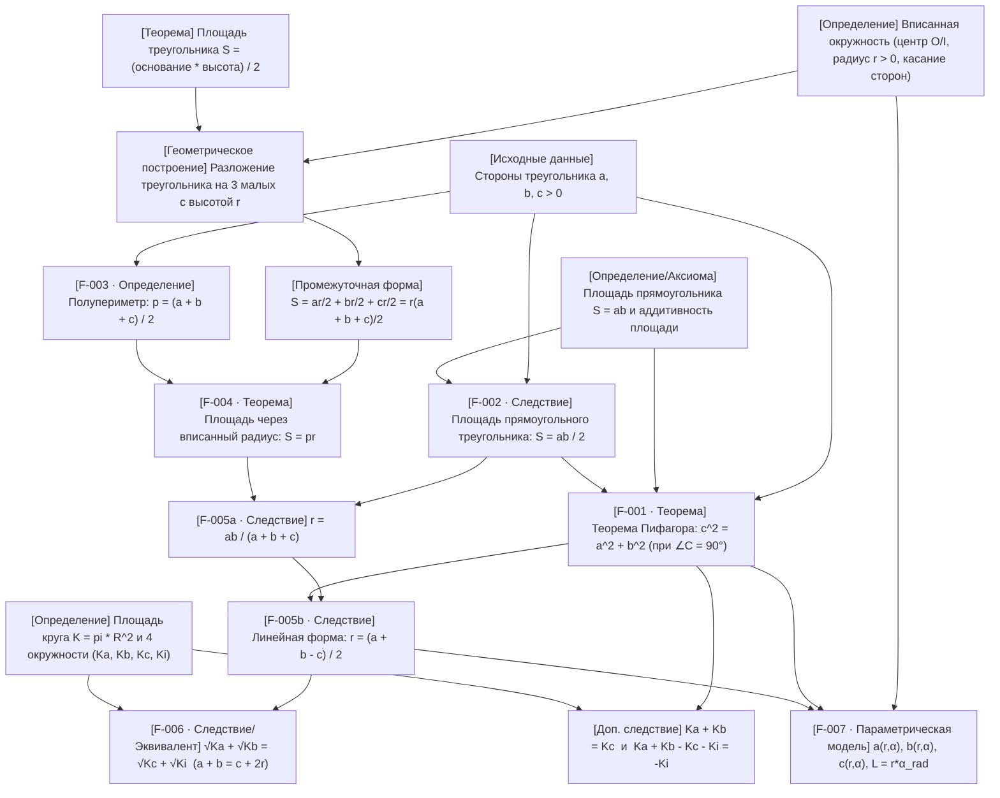

# Граф зависимостей семантических паспортов (`F-001` – `F-007`)

Этот документ фиксирует направленный ациклический граф (DAG) логических и вычислительных зависимостей между определениями, теоремами, следствиями и параметрической моделью в наборе паспортов [`F-001`](F-001-pythagorean-theorem.md) – [`F-007`](F-007-parametric-triangle-model.md).

---

## 1. Направленный граф зависимостей (Mermaid DAG)

---

## 2. Классификация узлов по логической природе

Чтобы не смешивать определения, теоремы и следствия, все узлы графа строго разделены по эпистемическим типам:

| Узел | Формула | Логический тип | Зависимости | Область общности |
|---|---|---|---|---|
| **Определение `F-003`** | $p = \dfrac{a+b+c}{2}$ | **Определение величины** (не теорема) | Длины сторон $a, b, c$ | Любой треугольник |
| **Определение кругов** | $K_a, K_b, K_c, K_i$ | **Геометрическое определение** | Площадь круга $\pi R^2$, квадраты на сторонах | Прямоугольный треугольник |
| **Теорема `F-001`** | $c^2 = a^2 + b^2$ | **Доказанная теорема** (евклидова планиметрия) | Аксиомы плоскости, площадь прямоугольника и $\frac{ab}{2}$ | Прямоугольные треугольники |
| **Формула `F-002`** | $S = \dfrac{ab}{2}$ | **Выводимое следствие** | Площадь прямоугольника $ab$ и конгруэнтность | Прямоугольные треугольники |
| **Формула `F-004`** | $S = pr = \dfrac{r(a+b+c)}{2}$ | **Доказанная теорема** | Разложение из центра $O$, высота $r \perp \text{стороне}$, `F-003` | **Любые** невырожденные треугольники |
| **Формула `F-005`** | $r = \dfrac{ab}{a+b+c} = \dfrac{a+b-c}{2}$ | **Выводимое следствие** | `F-001` + `F-002` + `F-004` | Прямоугольные треугольники |
| **Тождество `F-006`** | $\sqrt{K_a}+\sqrt{K_b}=\sqrt{K_c}+\sqrt{K_i}$ | **Эквивалентная переформулировка** `F-005` | `F-005` + определения $K_a, K_b, K_c, K_i$ | Прямоугольные треугольники |
| **Модель `F-007`** | $a(\alpha), b(\alpha), c(\alpha), L=r\alpha$ | **Параметрическая модель семейства** | Уравнение касательной, `F-001`, согласована с `F-005` | Прямоугольные треугольники с $r>0, \alpha\in(0^\circ,90^\circ)$ |

---

## 3. Сквозная логика семантической замкнутости

1. **Почему нельзя начинать с $S = pr$ как с аксиомы:** узел `F-004` опирается одновременно на геометрическое разложение (порождающее $\frac{r(a+b+c)}{2}$) и на определение `F-003` ($p = \frac{a+b+c}{2}$). Без обоих родителей формула теряет объяснение, откуда взялась буква $p$ и знаменатель $2$.
2. **Почему `F-005` связывает две ветви:** рациональная форма $r = \frac{ab}{a+b+c}$ соединяет общую формулу `F-004` с прямоугольной площадью `F-002`, а линейная форма $r = \frac{a+b-c}{2}$ добавляет теорему Пифагора `F-001`.
3. **Почему `F-006` не является независимой теоремой:** после извлечения корней и сокращения на $\frac{\sqrt{\pi}}{2}$ тождество $\sqrt{K_a}+\sqrt{K_b}=\sqrt{K_c}+\sqrt{K_i}$ сводится к $a + b = c + 2r$, то есть к переписанной формуле `F-005`.
4. **Почему `F-007` разделяет форму и масштаб:** фиксация $r$ задаёт окружность, а перекатывание касательной по углу $\alpha \in (0^\circ, 90^\circ)$ порождает всё семейство треугольников из `F-005` в обратном направлении $(r, \alpha) \mapsto (a, b, c)$.
